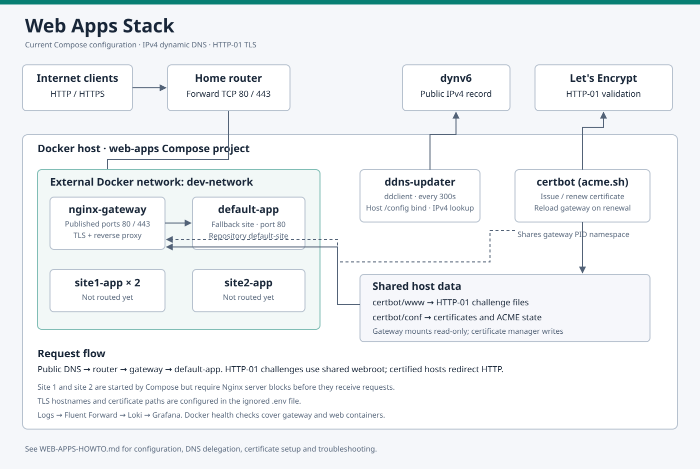

# Web apps stack: setup and operations



This guide describes [web-apps.yml](./web-apps.yml). Nginx serves the default
site for the configured hostnames. `site1-app` (two replicas) and `site2-app`
are available on the Docker network but are not routed until you add
hostname-specific Nginx configuration.

The Compose file and Nginx template intentionally contain no deployment
hostnames or certificate names. Put those values in the ignored `.env` file.

## 1. Prerequisites

- Docker Engine and Docker Compose 2.23.1 or later.
- A dynv6 zone and its HTTP token, and a reachable public IPv4 address. The
  configured DynDNS API updates IPv4 only, not AAAA records.
- Router access to forward TCP ports 80 and 443 to the Docker host. Reserve
  the host LAN address so forwarding remains valid.
- Ports 80 and 443 available on the host. A firewall, ISP restrictions, CGNAT,
  or a second router can prevent inbound access.

This host has other Docker services published on host ports. Only forward the
ports you intend to expose; Docker-published ports can bypass ordinary UFW
rules. Review Docker and firewall exposure before making the host public.

## 2. Configure environment and storage

Copy `.env.example` to `.env` only if `.env` does not already exist. Set
`DATA_DIR` to an absolute path on the Docker host. `REPO_DIR` is optional and
defaults to this Compose file's directory.

Configure the updater and Nginx variables in `.env`:

```dotenv
DDCLIENT_DAEMON=300
DDCLIENT_SYSLOG=no
DDCLIENT_SSL=yes
DDCLIENT_USEV4=webv4
DDCLIENT_WEBV4=https://api.ipify.org/
DDCLIENT_PROTOCOL=dyndns2
DDCLIENT_SERVER=dynv6.com
DDCLIENT_LOGIN=none
DYNV6_ZONE=your-zone.dynv6.net, *.your-zone.dynv6.net
DYNV6_TOKEN=your-http-token

NGINX_PRIMARY_HOSTS=your-domain.example
NGINX_PRIMARY_CERT_NAME=your-domain.example
NGINX_SECONDARY_HOSTS=www.your-domain.example
NGINX_SECONDARY_CERT_NAME=www.your-domain.example
NGINX_TLS_HOSTS=your-domain.example www.your-domain.example
```

Replace every example hostname and token with your own. The three
`NGINX_*_HOSTS` values are space-separated Nginx hostnames; do not quote the
values. `NGINX_PRIMARY_CERT_NAME` and `NGINX_SECONDARY_CERT_NAME` must match
the primary name and installed certificate directory for their respective
ACME certificates. Each certificate must cover every hostname listed for it.
Keep `.env` and backups private (`chmod 600 .env`). Compose renders the dynv6
token into a config stored on the Docker host; Docker administrators can read
it, and `docker compose config` prints it.

Create these directories under `DATA_DIR` before starting: `nginx/logs`,
`certbot/conf`, `certbot/www`, `site1-data`, and `site2-data`. The certificate
manager must be able to write to both `certbot` directories. The bind mounts
use `create_host_path: false`; Compose fails if sources are absent. Ensure
`default-site/`, `nginx/templates/`, and `nginx/ssl-params.conf` exist.

Create the shared network if it does not exist:

```bash
docker network inspect dev-network >/dev/null 2>&1 || docker network create dev-network
```

## 3. Configure dynv6

1. Create a zone at [dynv6](https://dynv6.com/) and create an HTTP token
   authorized for it.
2. Set `DYNV6_ZONE` to the exact records to update. Include each apex
   explicitly as well as wildcard records if both are needed; a wildcard does
   not cover the apex. Separate multiple records with commas.
3. Set `DYNV6_TOKEN` in `.env`, then start and inspect the updater:

   ```bash
   docker compose -f web-apps.yml up -d ddns-updater
   docker compose -f web-apps.yml logs -f ddns-updater
   ```

4. Verify each apex A record resolves to the current public IPv4. Disable any
   competing updater for the same records.
5. For a custom domain, ensure its authoritative DNS actually uses the record
   dynv6 updates. Delegate the zone to dynv6 or use a supported CNAME for a
   subdomain. A regular CNAME generally cannot be used at a zone apex; use
   delegation or your DNS provider's documented apex alias/flattening option.

When changing updater values, recreate the container to refresh its rendered
configuration:

```bash
docker compose -f web-apps.yml up -d --force-recreate ddns-updater
```

## 4. Issue certificates and start the gateway

Forward TCP 80 and 443 to the Docker host's LAN IP. HTTP port 80 must stay
reachable for ACME HTTP-01 challenges and renewal. The Nginx template uses
certificate paths based on the `NGINX_*_CERT_NAME` settings; those certificate
files must exist before starting the gateway.

For each configured certificate group, issue and install a certificate. Use
the actual primary hostname from the ignored `.env` in place of
`your-domain.example` below. Repeat for the secondary certificate group if
configured, using its primary hostname and certificate directory name:

```bash
docker exec certbot acme.sh --issue --server letsencrypt --webroot /var/www/certbot -d your-domain.example
docker exec certbot mkdir -p /acme.sh/live/your-domain.example
docker exec certbot acme.sh --install-cert -d your-domain.example --ecc \
  --key-file /acme.sh/live/your-domain.example/privkey.pem \
  --fullchain-file /acme.sh/live/your-domain.example/fullchain.pem \
  --reloadcmd 'kill -HUP 1'
```

On a new deployment, issue the initial HTTP-01 certificate before starting
Nginx with its HTTPS template. Use a temporary HTTP-only Nginx configuration
for ACME webroot validation, then restore the committed template after all
certificate files exist. Do not commit the temporary hostname-specific config.

Start the stack and validate it:

```bash
docker compose -f web-apps.yml up -d
docker compose -f web-apps.yml ps
docker exec nginx-gateway nginx -t
```

Nginx renders `nginx/templates/sites.conf.template` from `.env` at container
startup. Recreate it after changing hostnames or certificate directory names:

```bash
docker compose -f web-apps.yml up -d --force-recreate nginx-gateway
```

The certificate manager shares the gateway's process namespace, allowing
renewal hooks to reload Nginx without Docker socket access. If the gateway is
recreated outside Compose, recreate `certbot` as well. Check certificate
renewal state with `docker exec certbot acme.sh --list`.

HTTP redirects to HTTPS only for `NGINX_TLS_HOSTS`; unknown hostnames continue
to use the HTTP fallback. The default TLS server presents the primary
certificate for unknown HTTPS hostnames, so configure only hostnames covered
by the supplied certificates.

## 5. Replace the placeholder sites

The web containers serve static files from `default-site/`,
`DATA_DIR/site1-data`, and `DATA_DIR/site2-data`. Replace site content with
the built output of your Angular or React app, or replace a site service with
your own image and update its Nginx upstream. Add hostname-specific routing
and a matching certificate before directing a hostname to a site. For an SPA
using history-based routes, configure its site container's Nginx fallback
(for example `try_files $uri $uri/ /index.html`). The gateway only proxies
requests; it does not configure SPA routing. Preserve the `/` health endpoint
or update the Compose health check if your replacement image lacks `wget` or
does not serve `/`.

## 6. Monitoring, backups, and updates

Web container stdout/stderr is forwarded through the existing Fluent Forward
collector to Loki. In Grafana, use the Container Logs dashboard or Explore
with `{service_name="nginx-gateway"}`; substitute `ddns-updater`, `certbot`,
or a site service name for other logs. Docker health checks cover the Nginx
gateway and static web containers, but do not restart unhealthy containers or
check certificate expiry.

Prometheus metric-based uptime and certificate-expiry alerts are not currently
operational because the existing Prometheus data has a corruption error.
Recover Prometheus only after preserving its data, then configure probes,
Grafana alert rules, and a notification contact point. A separate external
monitor is needed to detect a complete host, router, or internet outage. Until
alerting is restored, inspect logs, service health, and certificate expiry
manually.

Back up `${DATA_DIR}/certbot/conf` (certificate keys and ACME account state),
site content, Nginx configuration, and `.env` to an access-controlled,
encrypted, off-host location. For example, after choosing a secure backup
directory, create a private archive:

```bash
umask 077
tar -C "$DATA_DIR" -czf /secure/backup/web-apps-certbot-conf.tar.gz certbot/conf
```

Replace the backup destination with your actual protected location. The
archive contains private keys: encrypt it and restrict access. Back up `.env`
separately, also encrypted. Test restoring to an isolated directory before
overwriting live certificate data. Verify restored key permissions and run
`nginx -t` before restarting the gateway.

Images are pinned by digest in Compose. Review and test new versions, then
deliberately update digests to receive security fixes; digest pins do not
update automatically.

## 7. Operations and troubleshooting

```bash
docker compose -f web-apps.yml ps
docker compose -f web-apps.yml logs --tail=100 ddns-updater nginx-gateway certbot
docker exec certbot acme.sh --list
docker exec nginx-gateway nginx -t
```

- **DNS wrong:** check the dynv6 zone, token, updater logs, and authoritative
  DNS for the hostname.
- **HTTP unreachable:** check router forwarding, host LAN IP, upstream NAT,
  ISP restrictions, and firewall. Test from outside the LAN.
- **HTTPS connection fails:** verify TCP 443 forwarding and that Nginx loaded
  a valid TLS server block and certificate.
- **Certificate warning:** ensure the requested hostname is included in the
  certificate; the fallback does not provide certificates for arbitrary hosts.
- **ACME renewal fails:** check public TCP 80, DNS, shared webroot access,
  certificate-manager logs, and expiry.
- **Site app not shown:** add matching Nginx routing and certificates;
  starting a site container alone does not publish or route it.
